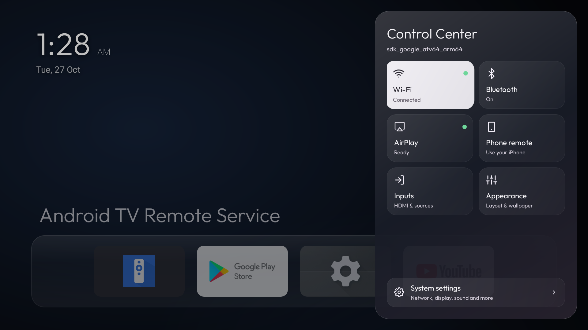
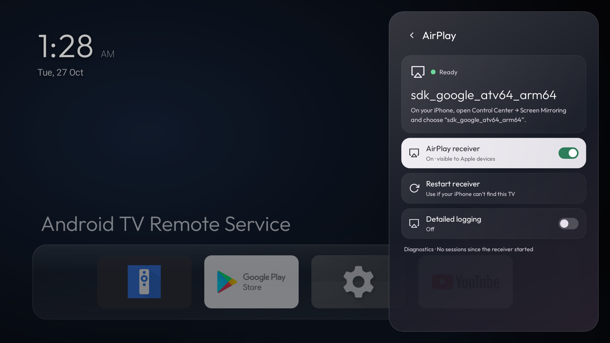
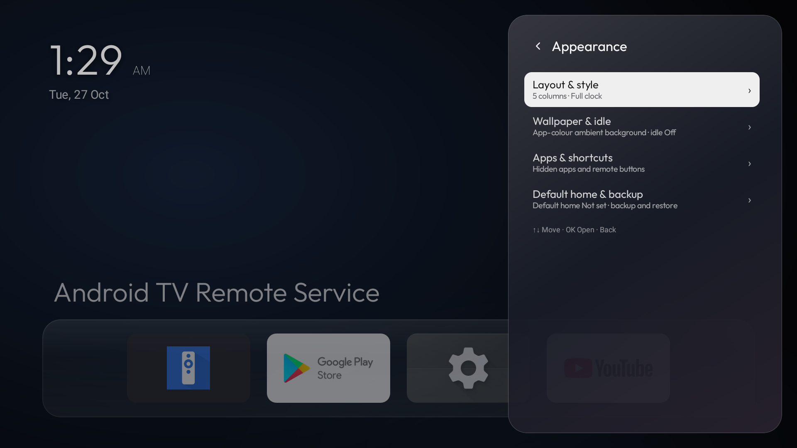

# Mirage

<p align="center">
  
</p>

**A fast, quiet home screen for Android TV with AirPlay built in.**

Mirage replaces the stock Google TV home with a calm, glass-styled launcher: a clock, an ambient background that takes its colour from the app you're on, and one row of favourite apps. Everything else stays out of the way until you ask for it. It has no ads, recommendations, accounts or telemetry.

<details>
<summary>More screenshots</summary>

### Control Center



### AirPlay



### Appearance



</details>

## Features

- **Home and All apps.** One favourites row on Home, with large 16:9 app banners. Press Down for a full-screen grid of every app, labelled and scrollable. Hold OK on an app to move, hide or inspect it.
- **Control Center.** A glass side sheet with live tiles for Wi‑Fi, Bluetooth, AirPlay, Phone remote, Inputs and Appearance, plus a shortcut to Android settings.
- **Bluetooth.** Paired devices sit one click from Home. Connect or disconnect audio devices, or pair new ones, in the same sheet.
- **Built-in AirPlay receiver.** iPhone, iPad and Mac can mirror the screen, play video (Photos, YouTube) and stream music to the TV. There's no separate app to install or keep alive. The receiver:
  - runs in a separate process from Home;
  - re-advertises itself when the network changes and repairs itself if it stops being visible;
  - decodes mirroring with asynchronous hardware MediaCodec straight to the screen surface;
  - uses low-latency audio;
  - trims YouTube HLS playlists to what the TV can play before playback starts.
- **Phone remote.** The TV serves its own remote web app on your home network:
  - scan the QR code in Control Center to pair, then add it to your Home Screen;
  - one-handed layout with a swipe touchpad or arrow buttons, playback, volume and keyboard text entry;
  - nothing is hosted in the cloud.
- **Gentle on old hardware.** Designed and tuned on a 2021 TCL Google TV (Android 11, 32-bit ARM, ~1.4 GB RAM). It works around that firmware's app freezer and boot-start restrictions.

## Building

Requirements:

- JDK 17
- Android SDK 36
- NDK `27.0.12077973`
- CMake `3.31.6`
- Gradle `8.14.5` (installed separately; wrapper scripts are not included)

The AirPlay engine pulls UxPlay, libplist, OpenSSL and FFmpeg as git submodules:

```sh
git clone --recursive https://github.com/HiteshRohira/Mirage.git
cd Mirage/glasslauncher
gradle --no-daemon :app:assembleRelease :app:testReleaseUnitTest :app:lintRelease
```

For an existing clone, initialize dependencies with
`git submodule update --init --recursive`. The first build compiles OpenSSL and
FFmpeg for the selected ABIs. The size-focused build produces standalone APKs
for both ARM ABIs by default; `-PtargetAbis=armeabi-v7a` or
`-PtargetAbis=arm64-v8a` builds only that ABI. Its release APKs are under
`glasslauncher/.build/crypto-size/app/outputs/apk/release/` with the default
native profile. Use fresh native build state when comparing variants.

To select a standalone APK for a TV, check its supported ABIs over ADB:

```sh
adb shell getprop ro.product.cpu.abilist
```

Use an `arm64-v8a` APK if that ABI is listed, or an `armeabi-v7a` APK if
that is supported. The device ABI list is authoritative; the CPU's advertised
bitness alone does not establish the installed Android userspace's support.
The size-focused build produces separate ABI APKs; select a matching one.

APK installation requires a signature. For a first installation, create and
secure your own Android signing keystore, then sign your APK with `apksigner`
using your key and alias. Never commit the keystore or its passwords. For an
update to an existing package, use the **same signing certificate** as that
installation; a different key cannot update it. JVM tests and lint do not execute
device tests.
The phone remote maintains a local ADB connection after Android authorization;
see [`glasslauncher/PHONE-REMOTE.md`](glasslauncher/PHONE-REMOTE.md).

## Project layout

- `glasslauncher/app` — the launcher: Home, All apps, Control Center, Bluetooth, the phone remote server and its web app.
- `glasslauncher/airplay` — the AirPlay engine and player:
  - native UxPlay core, with patches in `src/main/cpp/patches`;
  - Kotlin service and renderers;
  - the full-screen AirPlay player.

## Licensing

- Launcher code is under the **PolyForm Noncommercial License 1.0.0** ([LICENSE](./LICENSE), [NOTICE.md](./NOTICE.md)). Personal and other non-commercial use, modification and sharing are allowed; commercial use is not.
- The AirPlay module (`glasslauncher/airplay`) is adapted from [jqssun/android-airplay-server](https://github.com/jqssun/android-airplay-server) and builds on [UxPlay](https://github.com/FDH2/UxPlay). It is under the **GPL-3.0** ([glasslauncher/airplay/LICENSE](glasslauncher/airplay/LICENSE)).
- Third-party components keep their own licenses.

This project is personal and non-commercial; no APKs are published.

The application ID is `tv.mirage.launcher`. An installation using the earlier
ID is a separate app: Android does not move its private data automatically.
Export settings from the old app and restore supported settings and custom icons
in Mirage; wallpaper, phone pairings, local ADB authorization keys and other
private state are not covered by that backup. Re-pair and authorize as needed.
The two receivers can compete for network ports; stop the old receiver before
starting the new one, and keep the old app and data until migration is verified.
